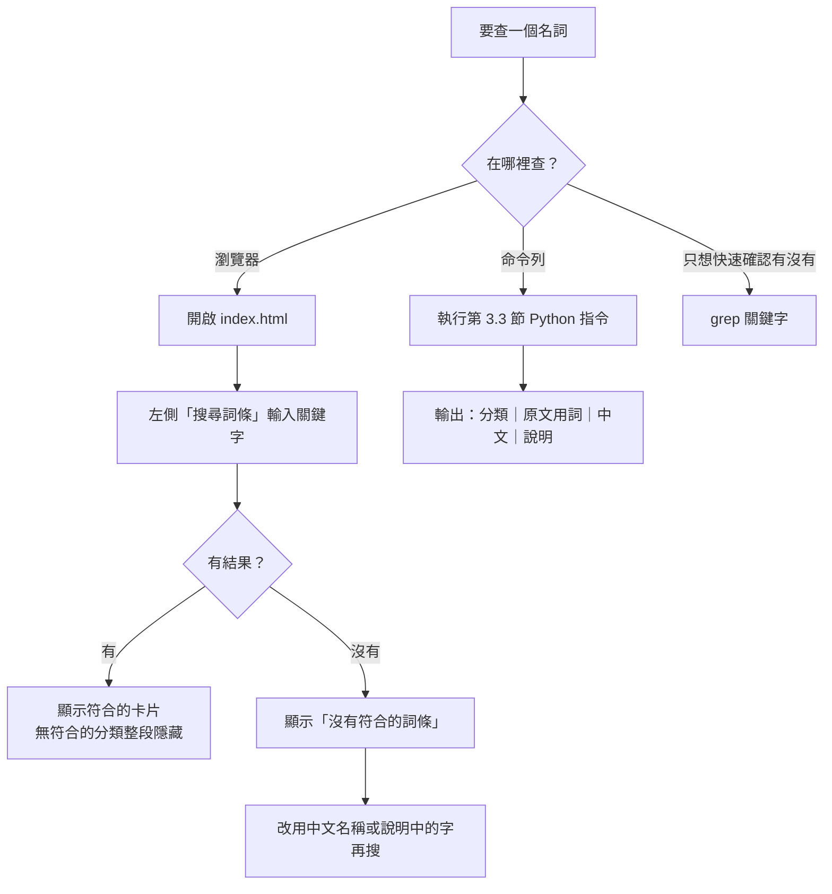

# glossary-spec：如何查詢一個名詞

> 適用對象：本 repo 的 `index.html`（軟體工程術語表・去敏公版）
> 依據：`main` 分支 commit `ed9ef6180374b765199a4b9b8090c1a2ab4d28ba`（2026-09-10）
> 本文件只新增於 `docs/glossary-spec` 分支，未修改 `main` 上任何檔案。

---

## 1. 這個 repo 是什麼

| 項目 | 內容 |
|---|---|
| 類型 | **詞彙表（內容）**，不是程式庫。唯一的程式碼是 `index.html` 內約 30 行的搜尋／跳轉 JavaScript |
| 檔案 | `index.html`（18,993 bytes）、`README.md`（1,405 bytes），共 2 個檔 |
| 資料格式 | **靜態 HTML**。詞條直接寫在 HTML 標記裡；repo 內**沒有** JSON、CSV 或 Markdown 資料檔 |
| 詞條數 | 50 筆，分 5 類（數字由 `.term-card` 實際計數得出，與頁尾文字「共 50 個通用詞條」一致） |
| 執行需求 | 瀏覽器直接開啟即可；字型由 Google Fonts 線上載入，離線時改用系統字型，不影響查詢 |

### 分類與筆數

| 區塊 id | 分類名稱 | 筆數 |
|---|---|---|
| `sec-git` | Git 基礎 | 12 |
| `sec-ci` | CI 與自動化 | 20 |
| `sec-deploy` | 部署與雲端 | 11 |
| `sec-quality` | 程式碼品質與前端 | 5 |
| `sec-abbr` | 常見縮寫 | 2 |
| | **合計** | **50** |

---

## 2. 資料結構（一筆詞條長什麼樣）

每筆詞條是一個 `.term-card`，固定三個欄位：

```html
<section id="sec-git">
  <h2>Git 基礎</h2>
  <div class="term-grid">
    <div class="term-card">
      <div class="head">
        <code>Repo</code>                     <!-- 欄位 1：原文用詞 -->
        <span class="zh">儲存庫</span>         <!-- 欄位 2：中文名稱 -->
      </div>
      <p class="explain">Git 中存放程式碼與版控紀錄的專案單位。</p>  <!-- 欄位 3：說明 -->
    </div>
  </div>
</section>
```

| 欄位 | HTML 位置 | 說明 |
|---|---|---|
| 分類 | 所屬 `<section>` 的 `<h2>` | 5 類之一 |
| 原文用詞 | `.head > code` | 部分詞條是多個詞合併，例如 `push / pull_request / schedule` |
| 中文 | `.head > span.zh` | 有些是英文對照，例如 `安全掃描` → `Security Scan` |
| 說明 | `p.explain` | 可能含內嵌 `<code>`，取文字時需去除標籤 |

**沒有的欄位**：證據等級、出處位置、ID、別名。查詢時無法依這些條件篩選。

---

## 3. 查詢方式



### 3.1 瀏覽器搜尋（一般使用）

1. 用瀏覽器開啟 `index.html`。
2. 在左側「搜尋詞條」輸入關鍵字，邊打邊篩選。
3. 也可點左側「大綱」按鈕，直接捲到該分類。

**比對規則**（依 `index.html` 內 `applyFilter()` 程式碼）：

| 規則 | 實際行為 |
|---|---|
| 比對範圍 | 整張卡片的文字（`card.textContent`）＝原文用詞＋中文＋說明 |
| 比對方式 | 子字串包含（`indexOf`），不是完整比對、不是模糊比對 |
| 大小寫 | 不分大小寫（雙方都轉小寫） |
| 前後空白 | 會先 `trim()` 去除 |
| 多個關鍵字 | **不拆字**。輸入 `CI 部署` 會當成一整串「ci 部署」去找 |
| 空字串 | 顯示全部 50 筆 |

**範例**

| 輸入 | 會找到 | 原因 |
|---|---|---|
| `canary` | 金絲雀部署 | 中文欄是 `Canary` |
| `ci` | 共 5 筆：`CI`、`check`、`供應鏈稽核`、`Workload Identity Federation`、`checkout` | 後 4 筆是說明文字含「CI」；子字串比對也可能命中英文字中間的 `ci`，關鍵字越短，多餘結果越多 |
| `鉤子` | `hook`、`husky`、`--no-verify` | 中文或說明含「鉤子」 |

### 3.2 命令列快速確認（grep）

只想知道某字有沒有出現：

```bash
grep -i 'canary' index.html | sed -E 's/<[^>]+>/ /g; s/ +/ /g'
```

限制：`index.html` 的搜尋框提示文字也含「canary」，所以結果會多一行空白的雜訊行；grep 不會告訴你屬於哪個分類。

### 3.3 命令列結構化查詢（Python，建議）

需求：Python 3（只用標準函式庫，不需安裝套件）。在 repo 根目錄執行：

```bash
python3 - CI <<'EOF'
import re, html, sys
q = sys.argv[1].lower()
src = open("index.html", encoding="utf-8").read()
for sec in re.finditer(r'<section id="([^"]+)">\s*<h2>([^<]+)</h2>(.*?)</section>', src, re.S):
    for m in re.finditer(r'<code>(.*?)</code><span class="zh">(.*?)</span></div><p class="explain">(.*?)</p>', sec.group(3)):
        term, zh, ex = (re.sub(r"<[^>]+>", "", html.unescape(x)) for x in m.groups())
        if q in f"{term} {zh} {ex}".lower():
            print(f"[{sec.group(2)}] {term}｜{zh}｜{ex}")
EOF
```

把 `CI` 換成要查的關鍵字。比對規則與瀏覽器相同（不分大小寫的子字串比對），但輸出會附分類名稱。

**已實際執行的結果（關鍵字 `CI`，2026-11-05）**：

```
[CI 與自動化] CI｜持續整合｜程式碼提交後自動執行建置與測試的流程。
[CI 與自動化] check｜檢查狀態｜GitHub 上 PR 所需的 CI 檢查結果是否全綠。
[CI 與自動化] 供應鏈稽核｜Supply-chain Gate｜檢查第三方套件是否安全的 CI 關卡。
[部署與雲端] Workload Identity Federation｜工作負載身份聯邦｜用短期令牌取代長期金鑰，讓 CI 安全存取雲端服務的機制。
[部署與雲端] checkout｜檢出｜CI 流程中將程式碼取出到執行環境的步驟。
```

**驗收方式**：把關鍵字改成空字串 `""` 執行，應輸出 50 行；少於 50 行表示 HTML 結構已被改動，正則需要更新。

---

## 4. 已知限制

| 限制 | 影響 |
|---|---|
| 沒有獨立資料檔 | 其他程式要重用詞條，只能從 HTML 解析（第 3.3 節）；HTML 標記一改，解析就可能失效 |
| 只有子字串比對 | 無同義詞、無拼字容錯；查 `Canary deploy` 找不到（卡片內沒有這串連續文字） |
| 多詞合併為一筆 | 例如 `lint / eslint` 是一筆，查 `eslint` 能找到，但結果會是合併後的整筆 |
| 無證據等級欄位 | 無法分辨哪些說明有原始文件支持、哪些是通用解釋 |
| README 與實際檔案不一致 | README 提到的 `Ssdc-Glossary-V5-Final-Unfrozen_去敏公版-CYC.html`、`Ssdc-Glossary-V5-Final-Unfrozen-CYC.html` 與 `reference/軟體工程術語表.html` 都**不在本 repo**；實際頁面檔名是 `index.html` |

---

## 5. 與內部版的關係（僅列計數）

依頁尾文字與實際比對：本表 50 筆是從內部版 86 筆詞條篩選、改寫而來。為避免把已去敏的內容帶回公開 repo，**本文件不列出被移除詞條的名稱或內容**。

| 項目 | 數字 | 依據 |
|---|---|---|
| 內部版詞條數 | 86 | 內部版資料檔實際計數 |
| 本表詞條數 | 50 | 本表 `.term-card` 實際計數 |
| 原文用詞與內部版完全相同 | 37 | 字串完全比對 |
| 改名／拆分後對應 | 13 | 人工比對（其中 2 筆由內部版同一筆拆成兩筆） |
| 本表對應到的內部版詞條（去重） | 49 | 37 ＋ 12 |
| 內部版未出現在本表 | 37 | 86 − 49 |

說明：頁尾寫「移除 36 個」，是用 86 − 50 計算；以去重後的來源詞條算則是 37 個。兩個數字差在「一筆拆成兩筆」的計算方式，不是資料遺漏。

另外，本表 50 筆的說明文字**全部經過改寫**（與內部版逐字比對，相同 0 筆），主要是刪掉「文中未定義，以下為通用解釋：」這類前綴與指回原始文件的措辭。
